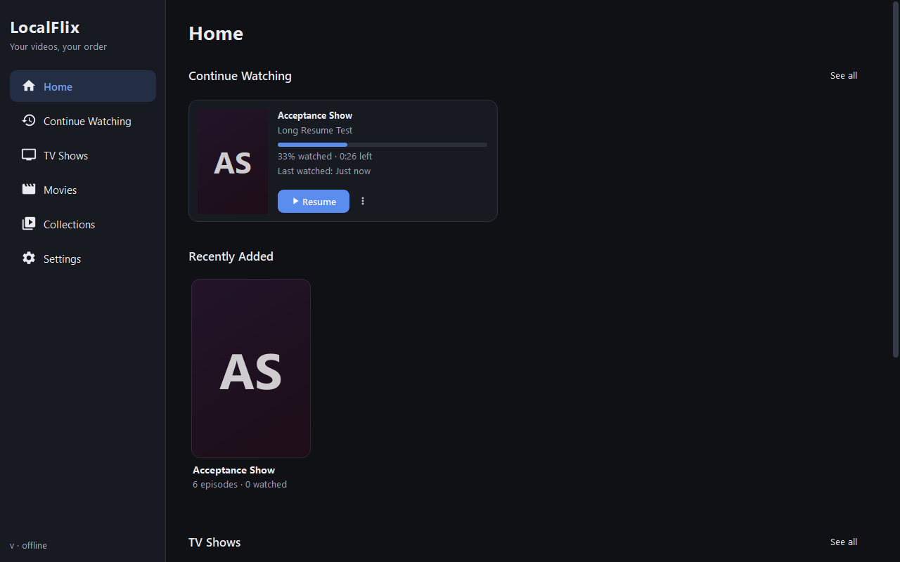
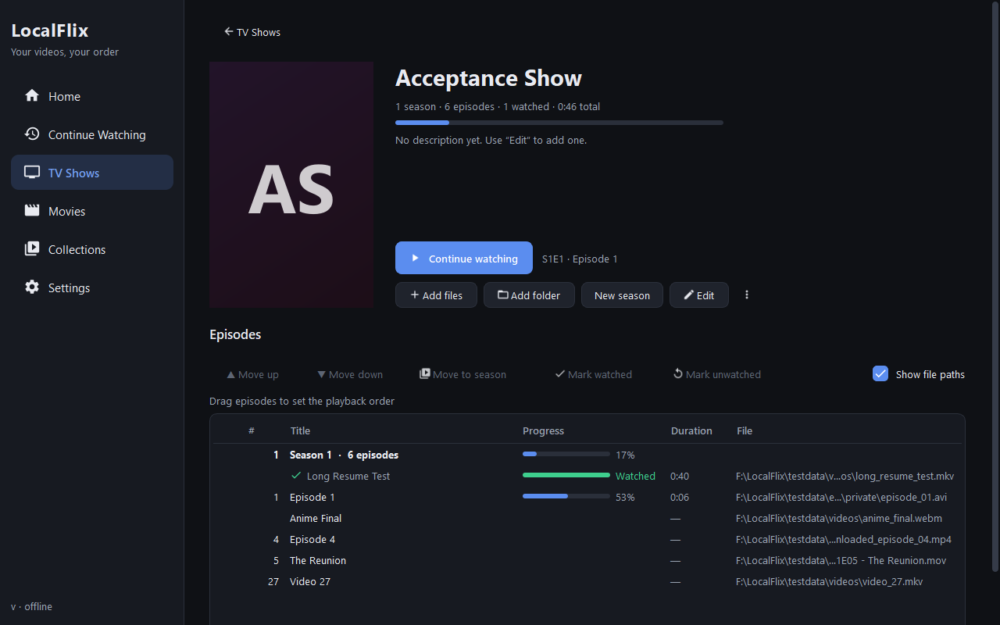
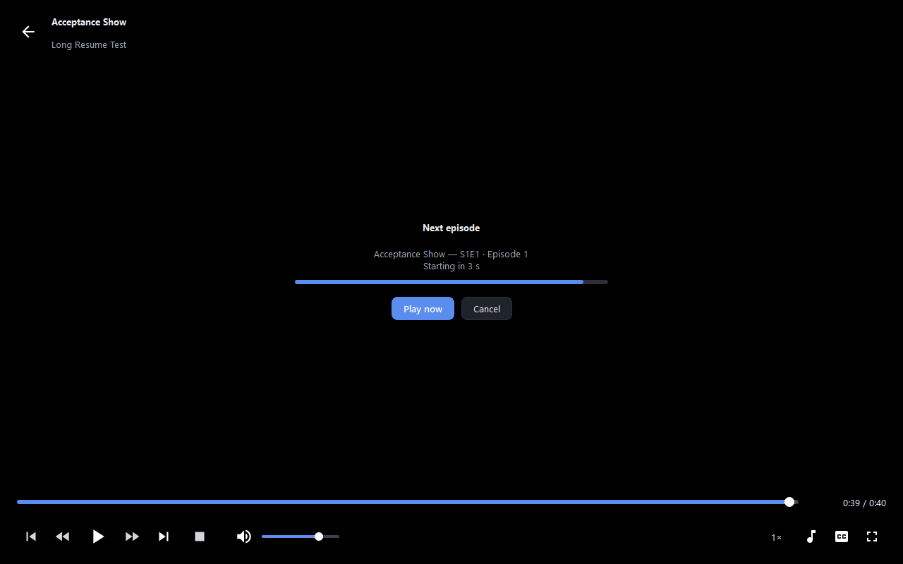

# LocalFlix

An offline video player with a Netflix-style library: import the videos you already have, put them in **your own
order**, and LocalFlix remembers exactly where you stopped, shows a **Continue Watching** row, and plays the **next
episode automatically**. Windows 10/11, C++20, Qt 6 Widgets, **libmpv** for playback, SQLite for the library.

* Your files stay where they are. LocalFlix never copies, moves or deletes a video.
* Works entirely offline. No account, no telemetry.
* Moved a file? **Locate missing file** reconnects it and keeps its progress and place in the order.







*(Screenshots are rendered by the test suite with Qt's software OpenGL.)*

## Install

Download **`LocalFlix-<version>-setup.exe`** from the [latest release](https://github.com/victorhmrod/LocalFlix/releases/latest)
and run it. It installs for your user account by default (no administrator rights needed; pick "install for all users"
in the dialog if you prefer), adds a Start Menu entry (and an optional desktop icon), and registers LocalFlix in
*Settings → Apps* for uninstalling. English and Brazilian Portuguese. Uninstalling removes the program and asks whether
to also delete your library; your video files are never touched.

The installer is not code-signed, so Windows SmartScreen may show *"Windows protected your PC"*: choose
*More info → Run anyway*. Verify the download against the published `.sha256` file if you want to be sure
(`certutil -hashfile LocalFlix-<version>-setup.exe SHA256`).

**Android:** there is a native Android version (Kotlin, Jetpack Compose, Room, Media3). Download the APK from the
[v1.0.0 release](https://github.com/victorhmrod/LocalFlix/releases/tag/v1.0.0); the code is in
[`android/`](android/README.md), which also explains the toolchain and how it is tested.

Prefer no installer? The release also has a portable **`LocalFlix-<version>-win64.zip`**: unzip anywhere and run
`localflix.exe`.

## Build from source

Requirements: Windows 10/11 x64, Visual Studio (Desktop development with C++), Qt 6.7 `msvc2019_64`, CMake, 7-Zip.
Details and version pins: [docs/DEPENDENCIES.md](docs/DEPENDENCIES.md).

```bat
git clone https://github.com/victorhmrod/LocalFlix.git
cd LocalFlix
scripts\fetch-deps.cmd     :: downloads + verifies libmpv (and mpv.exe for test clips)
build.cmd                  :: Release build -> build\Release\localflix.exe
scripts\package.cmd        :: self-contained folder + zip in dist\ (run this one to get a runnable app)
scripts\make-installer.cmd :: Windows installer in dist\installer\ (needs Inno Setup 6, see below)
```

`build\Release\localflix.exe` needs the Qt DLLs on `PATH`; the folder produced by `scripts\package.cmd`
(`dist\LocalFlix\localflix.exe`) is self-contained and is the easiest way to run the app.

Qt is expected in `D:\Qt\6.7.3\msvc2019_64`; elsewhere: `set LOCALFLIX_QT_DIR=C:\Qt\6.7.3\msvc2019_64` first.
`build.cmd Debug` builds a debug configuration.

### Tests

```bat
python scripts\make_test_videos.py   :: creates small synthetic clips in testdata\videos (needs mpv.exe from fetch-deps)
test.cmd                             :: builds, then runs everything through ctest
test.cmd Release -LE gui             :: headless suites only (no window)
test.cmd Release -R tst_library      :: one suite
```

| Suite | What it covers |
|---|---|
| `tst_parser` | episode/season detection from file and folder names, natural ordering |
| `tst_database` | creation, migrations (data kept, backup written, failure rolls back, newer schema refused), worker connections, settings persistence |
| `tst_library` | import, duplicates, stable ids, manual ordering, moves between seasons, deletion never touches files, relinking moved files/folders, collections |
| `tst_progress` | saving/restoring positions, write throttling, completion, resume target, Continue Watching |
| `tst_playback` | `PlaybackController` with a scripted backend: natural end vs. stop vs. error, stale/duplicate events, countdown, reorder during countdown, resume modes, missing files, auto-play settings |
| `tst_skip` | skip intro/ending: chapter-title classification, segment detection, and the controller rules (button state, automatic skip at most once, never while paused, endings finish only through end-of-file) |
| `tst_mpv_backend` | the **real libmpv** on real clips (mp4/mkv/webm/avi/mov): EOF/stop/error reasons and tokens, start offsets, tracks, chapters, speed/volume, seek-to-end = EOF, skip intro/ending, full series and resume flows |
| `tst_ui_e2e` | the §16 acceptance scenario through the **real window** with real libmpv: create, import, reorder, play, seek, close, reopen, resume, auto-advance, fullscreen/auto-hide/shortcuts, relink. Opens a window for ~30 s and writes screenshots to `build\Release\e2e-shots` |

The UI test renders with Qt's software OpenGL so it behaves the same on every machine
(`LOCALFLIX_E2E_HARDWARE_GL=1` uses the GPU). What automation does **not** cover is listed in
[docs/MANUAL_TEST_CHECKLIST.md](docs/MANUAL_TEST_CHECKLIST.md), together with the step-by-step acceptance scenario.

### Packaging

```bat
scripts\package.cmd
```

Builds Release, runs `windeployqt`, assembles `dist\LocalFlix\` (exe, `libmpv-2.dll`, Qt DLLs and plugins, MSVC
runtime, software OpenGL), smoke-tests it with **no Qt on `PATH`**, and writes `dist\LocalFlix-<version>-win64.zip`.
Unzip anywhere and run `localflix.exe`.

### Installer

```bat
winget install JRSoftware.InnoSetup   :: once
scripts\make-installer.cmd
```

Packages the application (same steps as `package.cmd`, into `dist\installer-staging`), compiles
[`installer\LocalFlix.iss`](installer/LocalFlix.iss) with Inno Setup 6 into
`dist\installer\LocalFlix-<version>-setup.exe` (+ `.sha256`), then **tests it for real**: a silent per-user install into a
temporary folder, a launch of the installed exe with no Qt on `PATH`, and a silent uninstall that must remove the
program and its Apps & features entry while leaving the library alone. The test refuses to run if LocalFlix is already
installed on the machine. `-SkipPackage` reuses the staging folder, `-SkipTest` skips the install test, and
`LOCALFLIX_ISCC` points to a non-standard `ISCC.exe`.

## Using LocalFlix

1. **TV Shows → New show**, then **Add files** / **Add folder** (sub-folders are included), or drop files and folders
   onto the page. `S02E05`, `1x03`, `Episode 4`, `- 07 -`, `Season 2\` folders are recognised; you can edit titles and
   numbers (`F2` or right-click → *Rename…*; double-click plays the episode).
2. **Order** the episodes: *Move up/down* buttons, `Ctrl+↑/↓`, or drag them (also across seasons and onto a season header).
   That order is exactly the playback order, whatever the file names say.
3. **Start watching**. Progress is saved every ~5 s, on pause, when you switch episode and when you close the window.
4. Next time: **Home → Continue Watching → Resume** (or **Continue** on the show page). When an episode ends, a
   countdown starts the next one in your order; **Cancel** stops it.
5. **Movies** work the same way with a poster and custom title. **Collections** group shows and movies and play them in a
   sequence you choose.

### Player shortcuts

| Key | Action | Key | Action |
|---|---|---|---|
| `Space` / `K` | play / pause | `N` / `PgDn` | next |
| `←` `→` | −5 s / +5 s | `P` / `PgUp` | previous |
| `Shift+←` `Shift+→` | −30 s / +30 s | `[` `]` | speed −0.25 / +0.25 |
| `J` `L` | −10 s / +10 s | `Home` | restart |
| `↑` `↓` / mouse wheel | volume ±5 | `S` | cycle subtitles (incl. off) |
| `M` | mute | `A` | cycle audio tracks |
| `F` / `F11` / `Alt+Enter` / double-click | fullscreen | `0`–`9` | jump to 0 %–90 % |
| `Esc` | leave fullscreen, then leave the player | click | play / pause |
| `Enter` | press **Skip Intro** / **Skip Ending** while the button is shown | | |

Library: `Ctrl+1…6` switch screens, `Del` removes the selected episodes from the library (files are kept).

### Skipping openings and endings

When the file has chapters titled like an opening or an ending (`Opening`, `OP`, `OP1`, `Intro`, `Abertura` /
`Ending`, `ED`, `Credits`, `Créditos`, `Encerramento`…), a **Skip Intro** / **Skip Ending** button appears at the
bottom right while the video is inside it (click it or press `Enter`). Two options in *Settings → Playback* skip them
by themselves; both are off by default. Skipping an opening jumps to the next chapter. Skipping an ending that lasts
until the end of the file seeks to the end, so the episode finishes and the next one starts exactly as if it had been
watched (including the countdown); an ending followed by its own chapter, such as a post-credits scene, jumps to that
chapter and keeps playing. Automatic skipping happens at most once per opening/ending and never after you seek into it
yourself. Files without such chapters (most plain downloads) have nothing to skip: detection reads the chapters,
it does not analyse audio or video.

### Settings

Auto-play next episode and its countdown (0–30 s); resume automatically or ask; skip already-completed episodes when
advancing; automatically skip openings and endings; preferred audio/subtitle language; default volume and speed; fullscreen behaviour (manual / start in
fullscreen / remember); default import folder; a file check that finds moved or missing files.

### Where things are stored

`%APPDATA%\LocalFlix\` (override with the `LOCALFLIX_DATA_DIR` environment variable): `library.db` (SQLite, WAL),
`covers\` (copies of the cover/poster images you chose), `localflix.log`, and `library.db.bak-v<N>` after a migration.
Deleting a show removes its rows and cover copy, never your videos.

## Troubleshooting

| Problem | What to do |
|---|---|
| Window is blank/white or video is black | start with `localflix.exe --software-opengl` (Qt's bundled software OpenGL; slower) and report your GPU + driver |
| "The video engine could not be loaded" | `libmpv-2.dll` must sit next to `localflix.exe` (`scripts\fetch-deps.cmd`, or use the packaged zip) |
| Episode shows ⚠ / "File not found" | the file moved or its drive is disconnected: right-click → **Locate missing file…** (or the button on the error card) |
| Need details | `%APPDATA%\LocalFlix\localflix.log`; for chatty logs set `QT_LOGGING_RULES=localflix.*=true` |
| Render the window to an image | `localflix.exe --screenshot out.png` |

## Project layout

```
src/core    GUI-free logic (database, library, queue, progress, playback state machine, settings, import)
src/mpv     libmpv backend + the QOpenGLWidget that renders into the window
src/ui      widgets, views, theme
src/app     main.cpp
tests/      Qt Test suites + FakeBackend
scripts/    env/fetch-deps/package, test-video and icon generators
docs/       ARCHITECTURE.md, DEPENDENCIES.md, MANUAL_TEST_CHECKLIST.md
cmake/      libmpv import-library generator
```

Architecture, threading rules, the SQLite schema and the reasoning behind the main decisions (Widgets +
`QOpenGLWidget`/render API instead of `--wid`, a separate `media_files` table, event-token based playback) are in
[docs/ARCHITECTURE.md](docs/ARCHITECTURE.md).

## Known limitations

* Windows only; x64 only. Needs a GPU/driver that can present OpenGL 3.3 (or use `--software-opengl`).
* Hardware decoding is requested with libmpv's `hwdec=auto-safe`; which decoder is actually used depends on mpv and your GPU driver (the automated tests only exercise software decoding).
* Episode thumbnails and metadata lookup are not implemented (descriptions and covers are manual, by design: no internet).
* Skip intro/ending works from the file's embedded chapters only; there is no audio fingerprinting and no manual marking, so a file with no (or unlabelled) chapters shows no Skip button.
* Subtitles/audio selections are remembered per file, not globally.
* Progress positions shorter than 5 s are not resumed (a deliberate rule so an accidental click does not hijack "Continue").

## Status

LocalFlix 1.0 is feature-complete for the scope above and passes its automated suites (see *Tests*). It has been
developed and verified on Windows 11. Hardware-OpenGL presentation on a range of GPUs/drivers and a few real-world
scenarios (OS-level drag-and-drop, multi-track media, second monitors) are only covered by the manual checklist, so
**bug reports are very welcome**; please include your GPU/driver, Windows version and `%APPDATA%\LocalFlix\localflix.log`.

## Contributing

Issues and pull requests are welcome.

* Build with `build.cmd` and run `test.cmd` before sending a change. Warnings are errors (`/W4 /WX`), so a clean build must stay clean.
* Add or update a test for behaviour changes. Playback rules live in `src/core` and are testable with the scripted `FakeBackend`; anything involving libmpv belongs in `tst_mpv_backend`.
* Commits follow [Conventional Commits](https://www.conventionalcommits.org/) (`feat(queue): …`, `fix(progress): …`, `docs: …`), one logical change per commit.
* Never make a change that copies, moves or deletes a user's video files: a hard rule of the project.
* Read [docs/ARCHITECTURE.md](docs/ARCHITECTURE.md) first; it explains the threading rules and why playback is token-based.

## Licence

LocalFlix is free software released under the **GNU Affero General Public License v3.0** (see [LICENSE](LICENSE)).
Third-party components keep their own licences: [THIRD_PARTY_NOTICES.md](THIRD_PARTY_NOTICES.md).
